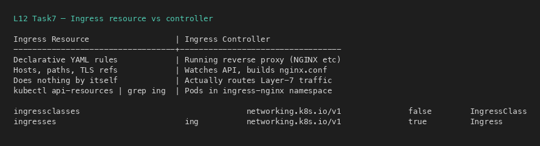
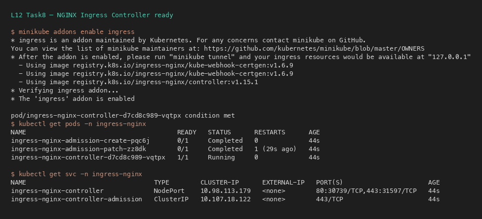
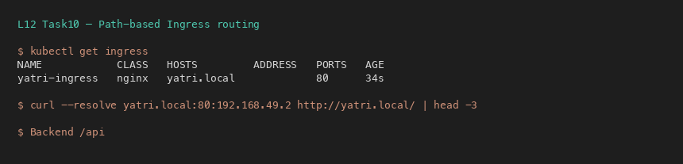

# Ingress vs Ingress Controller

**Author:** Kushal S  
**Enrollment:** 24bcs10355  
**Session:** 12 — Kubernetes Ingress, ConfigMaps & Secrets

## What is Ingress?

An **Ingress** is a Kubernetes API object (`kind: Ingress`) that declares HTTP/HTTPS routing rules:

- Host-based routing (`yatri.local` → frontend Service)
- Path-based routing (`/api` → backend Service)
- TLS termination (certificates referenced by Secret)

By itself, an Ingress **does nothing**. It is only a desired-state document stored in etcd.

```yaml
apiVersion: networking.k8s.io/v1
kind: Ingress
metadata:
  name: yatri-ingress
spec:
  rules:
    - host: yatri.local
      http:
        paths:
          - path: /
            pathType: Prefix
            backend:
              service:
                name: yatri-frontend
                port:
                  number: 80
```

## What is an Ingress Controller?

An **Ingress Controller** is a running process (usually a Deployment of pods) that:

1. Watches the Kubernetes API for Ingress objects
2. Translates those rules into a reverse-proxy config (NGINX, Traefik, HAProxy, AWS ALB, …)
3. Reloads that proxy so traffic is routed to the matching Services/Pods

On Minikube this is typically:

```bash
minikube addons enable ingress
kubectl get pods -n ingress-nginx
```

## Difference between them

| | Ingress (resource) | Ingress Controller |
|---|---|---|
| What it is | YAML / API object | Running software (pods) |
| Purpose | Declare *what* routes exist | Implement *how* traffic is routed |
| Alone | No effect | Can run with zero Ingresses (idle) |
| Examples | `Ingress` manifest | NGINX Ingress, Traefik, Contour, ALB controller |

## Why both are required

```text
Client
  → Ingress Controller (proxy)
    → reads Ingress rules
      → Service
        → Pods
```

- Without an **Ingress**: you have no declarative HTTP routing object.
- Without a **Controller**: Ingress objects sit unused; nothing listens or routes.

You need **both**: the rule sheet (Ingress) and the engine that obeys it (Controller).

## Examples

| Scenario | Ingress | Controller |
|---|---|---|
| Minikube lab | `ingress.yaml` with host `yatri.local` | `ingress-nginx` addon |
| Path rewrite `/api` → backend | annotations on Ingress | NGINX controller applies rewrite |
| TLS | `tls:` block + TLS Secret | Controller terminates HTTPS |

## Hands-on evidence / screenshots

### Ingress resource vs controller



### Ingress controller pods running



### Path-based routing working



Full walkthrough: [../README.md](../README.md) Tasks 7–13.
