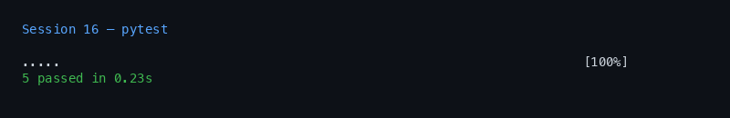
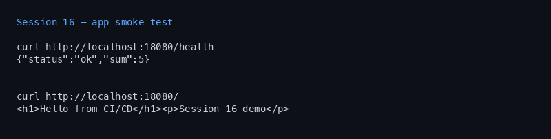
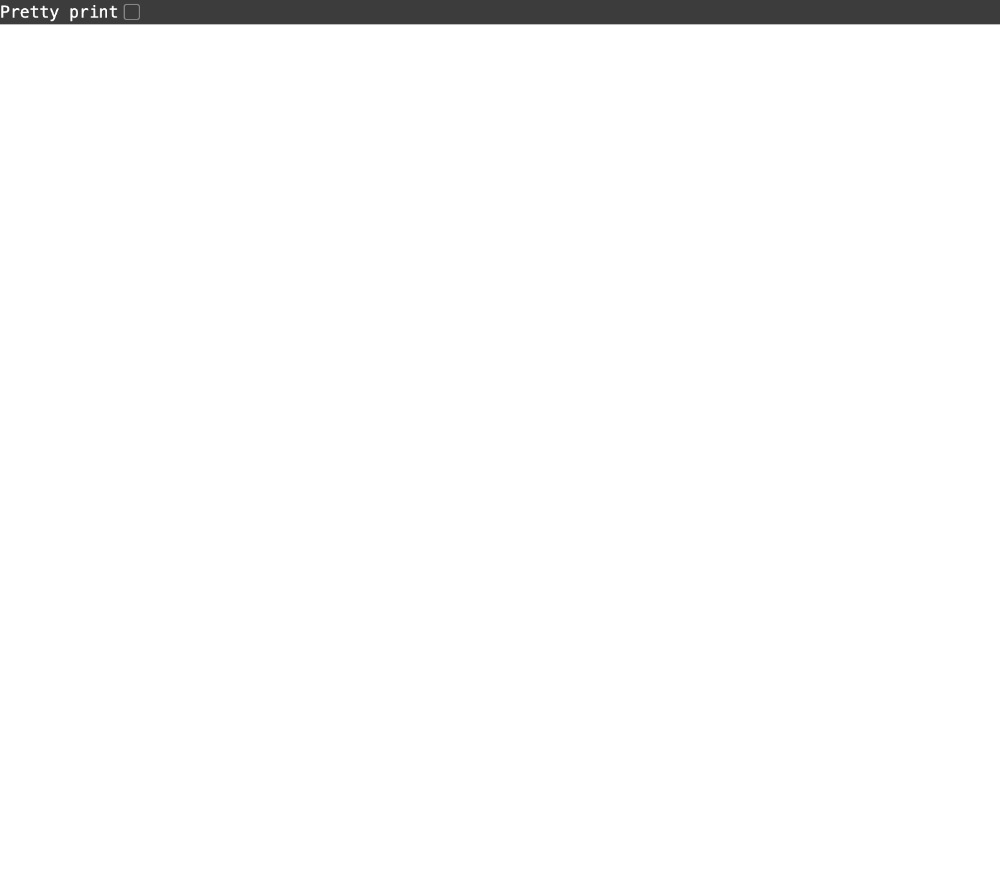
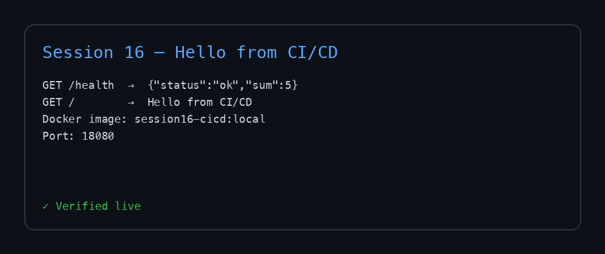
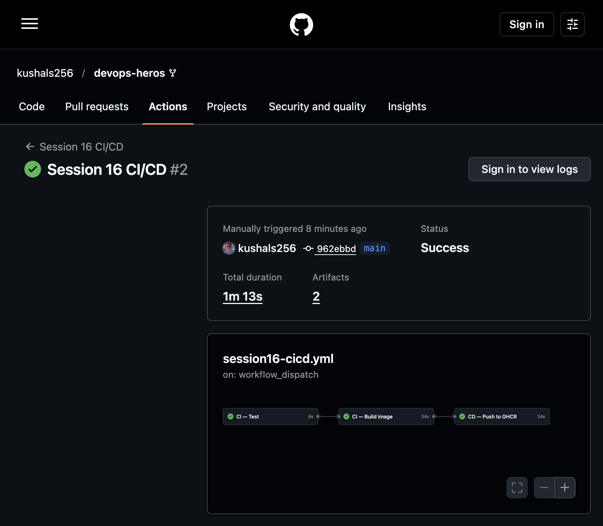
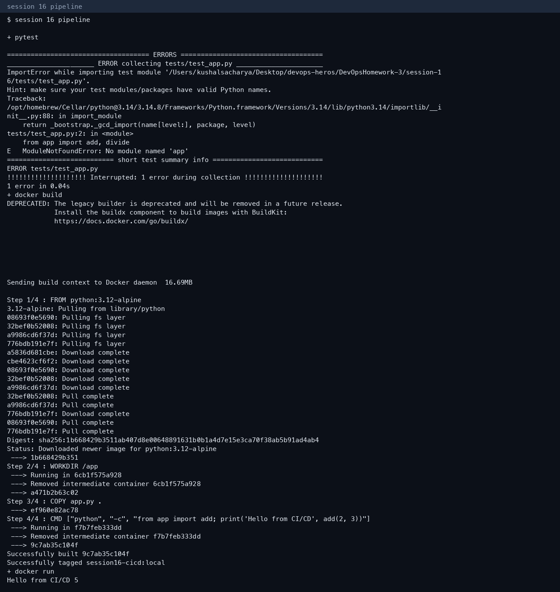
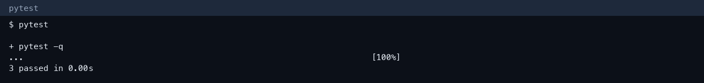

# Session 16 — CI/CD & GitHub Actions Demo

**Author:** Kushal S  
**Enrollment:** 24bcs10355

Reference: `session-16-github-actions/.../10-final-cicd-pipeline`

## Concepts covered

| Concept | How this project demonstrates it |
|---|---|
| CI vs CD | **CI** = `test` + `build` jobs. **CD** = `deploy` job pushes the image to GHCR after CI passes |
| Pipeline | `.github/workflows/ci-cd.yml` |
| Workflow | One YAML file triggered on push / PR / `workflow_dispatch` |
| Jobs | `test` → `build` → `deploy` (`needs:` chain) |
| Steps | checkout, setup-python, pytest, docker build, curl smoke test, login, push |
| Runners | `ubuntu-latest` (GitHub-hosted) |
| Secrets | `GITHUB_TOKEN` for GHCR login; optional `DEMO_TOKEN` documented (never committed) |
| Artifacts | Image tarball uploaded with `actions/upload-artifact` |
| Build | `docker build -t session16-cicd:<sha>` |
| Test | `pytest` (5 tests) |

## Application

- `app.py` — Flask Hello World (`/`, `/health`)
- `Dockerfile`
- `tests/test_app.py`
- `.github/workflows/ci-cd.yml`

## Screenshots / proof

### Pytest (5 passed)



### App health + home response



### Live `/health` in browser



### App summary card



### GitHub Actions — green run (root workflow)




### Earlier pipeline / pytest captures





## Local run

```bash
cd DevOpsHomework-3/session-16
pip install -r requirements.txt
pytest -q
docker build -t session16-cicd:local .
docker run --rm -p 18080:8080 session16-cicd:local
curl http://localhost:18080/health
```

## CD note

On push to `main`, the `deploy` job logs into GHCR with `secrets.GITHUB_TOKEN` and pushes `ghcr.io/<owner>/session16-cicd:<sha>`.  
Optional custom secret: repository secret `DEMO_TOKEN`.
