# Session 17 — Complete CI/CD + DevSecOps

**Author:** Kushal S  
**Enrollment:** 24bcs10355

## Expected flow

```text
Code → Unit Test → SAST (Bandit) → SCA (pip-audit) → Secret Scan
  → Docker Build → Trivy (HIGH/CRITICAL exit 1) → Push GHCR → Deploy (kind)
```

## Deliverables

| Item | Path |
|---|---|
| Application | `app/app.py` |
| Dockerfile | `Dockerfile` |
| Tests | `tests/test_app.py` |
| Workflow | `.github/workflows/devsecops.yml` |
| Security notes | `SECURITY.md` |
| Kubernetes | `k8s/deployment.yaml`, `k8s/service.yaml` |

## Screenshots / proof

### Unit tests (3 passed)

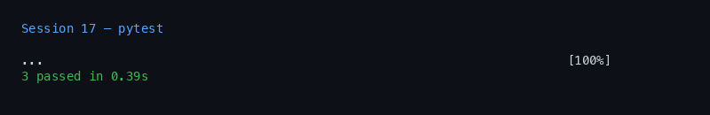

### SAST — Bandit (no issues)

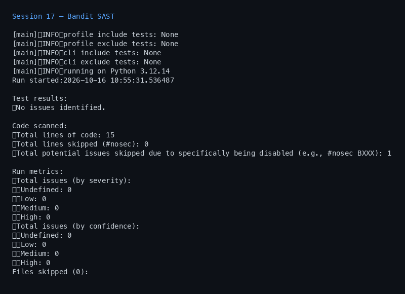

### SCA — pip-audit (no known vulns in requirements.txt)

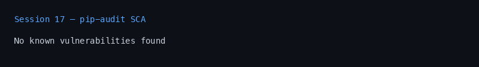

### Secret scan passed

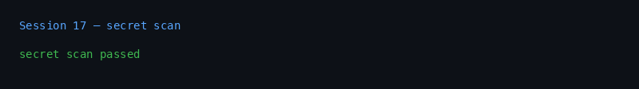

### App running in Docker

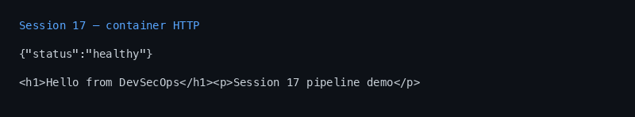

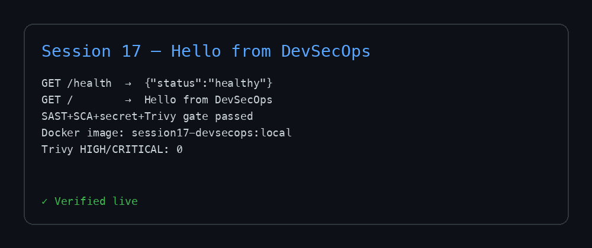

### Trivy image scan — Total HIGH/CRITICAL: 0

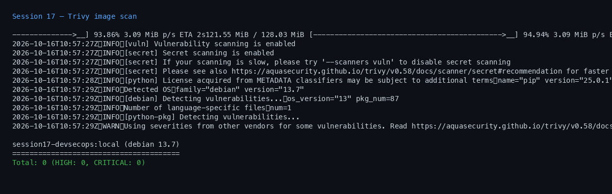

### GitHub Actions — green run (root workflow)

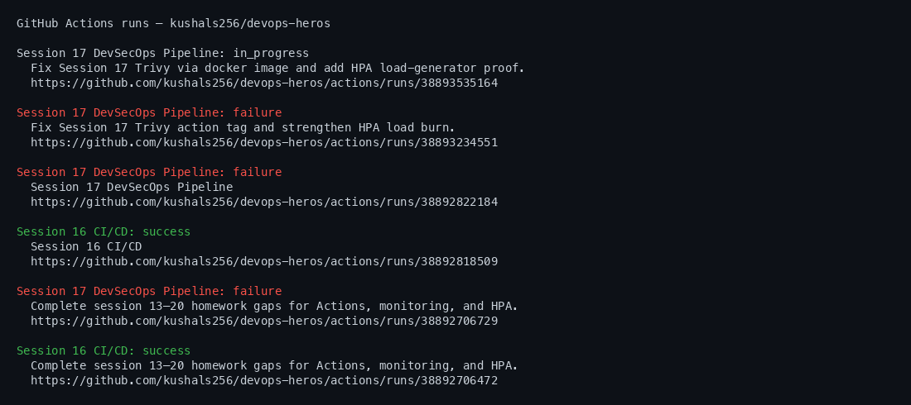

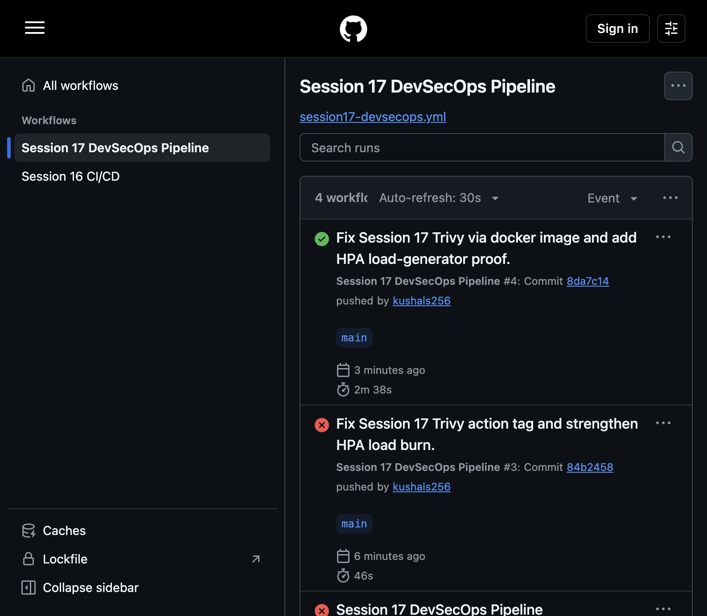

### Earlier captures

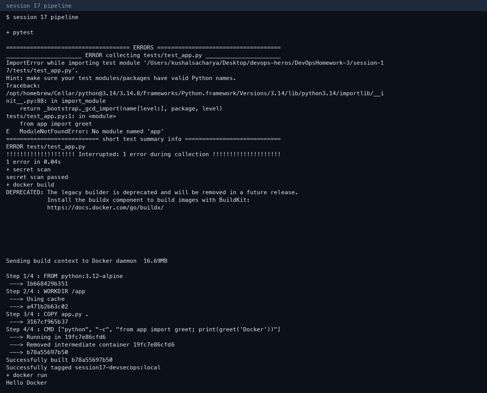

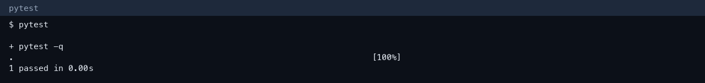

## Evidence table

| Stage | Result | Log |
|---|---|---|
| Unit test | **3 passed** | `logs/03-pytest.txt` |
| SAST (Bandit) | No issues | `logs/04-bandit.txt` |
| SCA (pip-audit) | No known vulnerabilities | `logs/05-pip-audit.txt` |
| Secret scan | passed | `logs/06-secret-scan.txt` |
| Docker / HTTP | healthy + Hello HTML | `logs/08-health.txt`, `logs/09-home.txt` |
| Trivy | **Total: 0** | `logs/10-trivy.txt` |

GitHub Actions workflow runs the same stages end-to-end including GHCR push and kind deploy.
