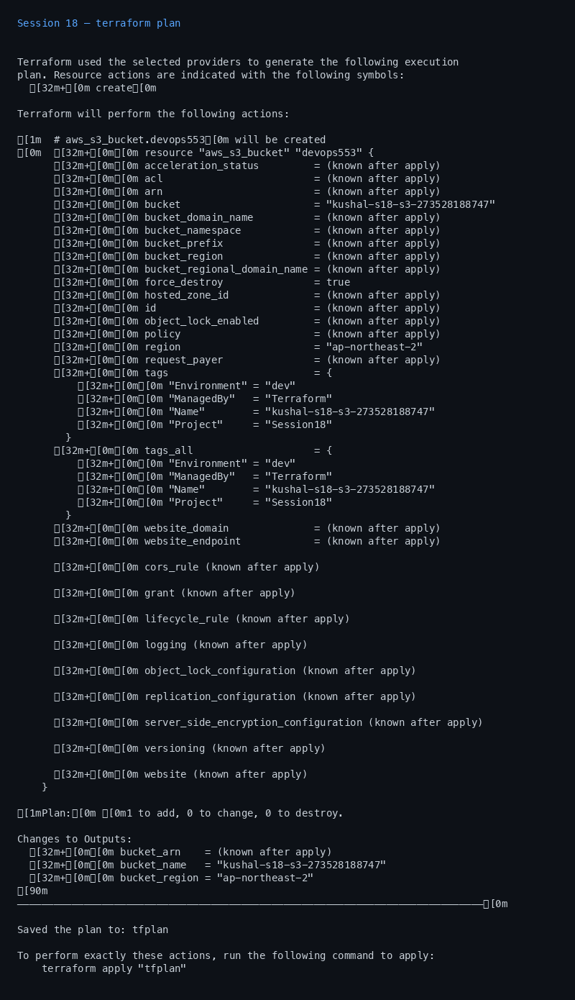
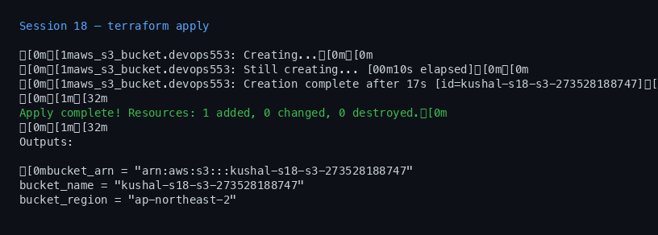
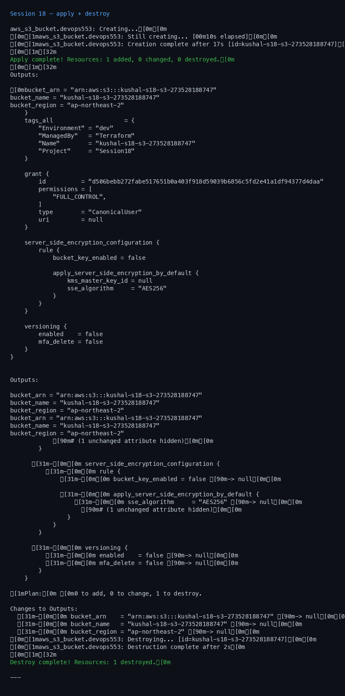
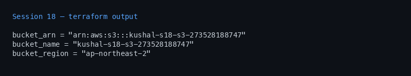
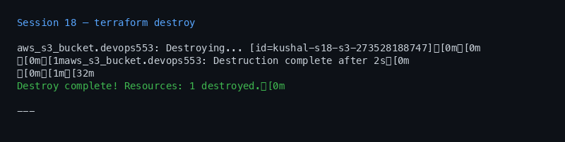
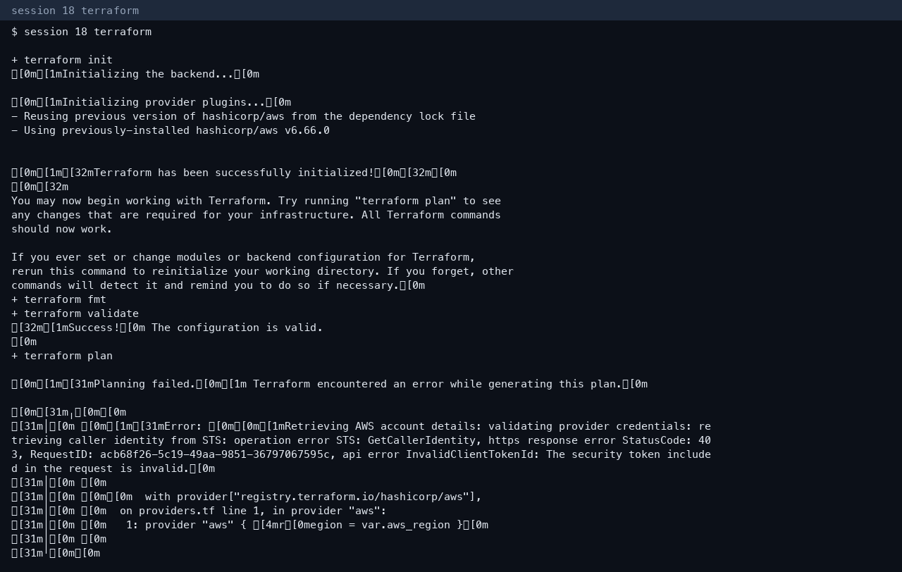

# Session 18 — Terraform S3 and AWS services

**Author:** Kushal S  
**Enrollment:** 24bcs10355

## Task 1 — S3 project

Project: `session18-terraform-iac/terraform-s3-demo/`

Bucket used in this run: `kushal-s18-s3-273528188747` (region `ap-northeast-2`).

### Workflow (executed successfully)

| Command | Result | Log |
|---|---|---|
| `terraform init` | AWS provider installed | `logs/02-init.txt` |
| `terraform fmt` | Already formatted | — |
| `terraform validate` | Configuration is valid | `logs/03-validate.txt` |
| `terraform plan` | Plan: 1 to add | `logs/04-plan.txt` |
| `terraform apply` | **Apply complete! Resources: 1 added** | `logs/05-apply.txt` |
| `terraform show` | Bucket + tags + SSE-S3 | `logs/06-show.txt` |
| `terraform output` | name / arn / region | `logs/07-output.txt` |
| `terraform destroy` | **Destroy complete! Resources: 1 destroyed** | `logs/08-destroy.txt` |

### Screenshots / proof

#### terraform plan



#### terraform apply



#### apply + destroy summary



#### terraform output



#### terraform destroy



#### Earlier workflow capture



### Apply outputs

```text
bucket_arn    = "arn:aws:s3:::kushal-s18-s3-273528188747"
bucket_name   = "kushal-s18-s3-273528188747"
bucket_region = "ap-northeast-2"
```

The bucket was destroyed after evidence capture.

## Task 2 — AWS service notes

| Service | README |
|---|---|
| IAM | `session18-terraform-iac/aws-services/01-iam/README.md` |
| EC2 | `session18-terraform-iac/aws-services/02-ec2/README.md` |
| S3 | `session18-terraform-iac/aws-services/03-s3/README.md` |
| VPC | `session18-terraform-iac/aws-services/04-vpc/README.md` |
| DynamoDB and RDS | `session18-terraform-iac/aws-services/05-dynamodb-rds/README.md` |
