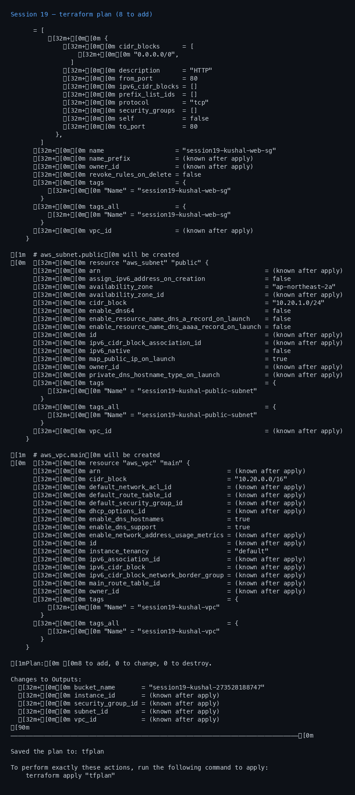
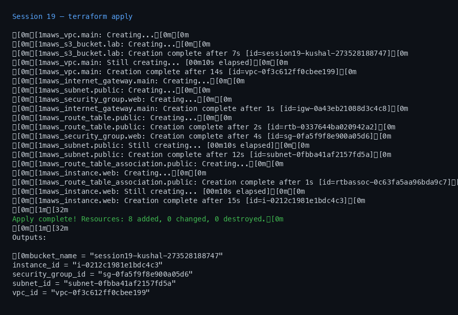
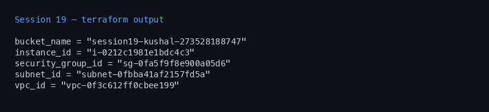
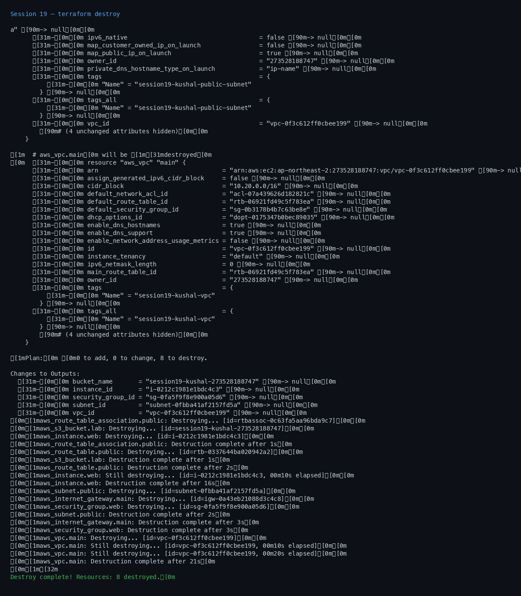
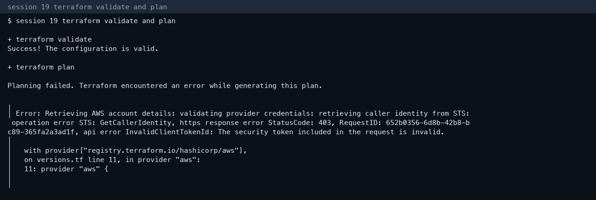

# Session 19 — Cloud infrastructure with Terraform

**Author:** Kushal S  
**Enrollment:** 24bcs10355  
**Region:** `ap-northeast-2` (Seoul)  
**AWS Account:** `273528188747`

## Architecture

```text
Terraform
    |
    ├── VPC 10.20.0.0/16              aws_vpc.main
    |
    ├── Public subnet 10.20.1.0/24    aws_subnet.public
    |
    ├── Internet gateway              aws_internet_gateway.main
    |     └── public route 0.0.0.0/0
    |
    ├── Security group                aws_security_group.web  (TCP 80)
    |
    ├── EC2 t4g.micro                 aws_instance.web (AL2023 + nginx)
    |     └── depends_on the internet gateway
    |
    └── S3                            aws_s3_bucket.lab
```

Mermaid diagram: [architecture.md](architecture.md).

## Workflow (executed successfully)

| Command | Result | Log |
|---|---|---|
| `terraform init` | OK | `logs/02-init.txt` |
| `terraform validate` | Valid | `logs/03-validate.txt` |
| `terraform plan` | **8 to add** | `logs/04-plan.txt` |
| `terraform apply` | **8 added** | `logs/05-apply.txt` |
| `terraform output` | Resource IDs | `logs/06-output.txt` |
| `terraform destroy` | **8 destroyed** | `logs/08-destroy.txt` |

## Screenshots / proof

### terraform plan (8 to add)



### terraform apply



### terraform output (live resource IDs)



### terraform destroy (8 destroyed)



### Earlier plan attempt



## Live outputs from apply

```text
bucket_name       = "session19-kushal-273528188747"
instance_id       = "i-0212c1981e1bdc4c3"
security_group_id = "sg-0fa5f9f8e900a05d6"
subnet_id         = "subnet-0fbba41af2157fd5a"
vpc_id            = "vpc-0f3c612ff0cbee199"
```

All resources were destroyed after evidence capture to avoid ongoing AWS cost.
