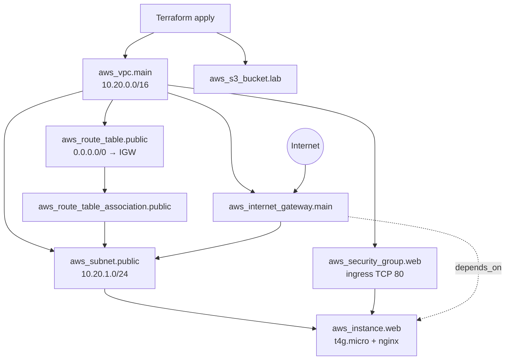

# Session 19 — Architecture diagram

**Author:** Kushal S · **Enrollment:** 24bcs10355

## Resource map

| Layer | Resource | Purpose |
|---|---|---|
| Network | VPC + public subnet + IGW + route | Reachable public network |
| Security | Security group | Allow HTTP 80 |
| Compute | EC2 `t4g.micro` | nginx Hello World via user-data |
| Storage | S3 bucket | Lab object storage |

This matches the course suggested architecture: **VPC → Subnet → Security Group → EC2 → S3**.
