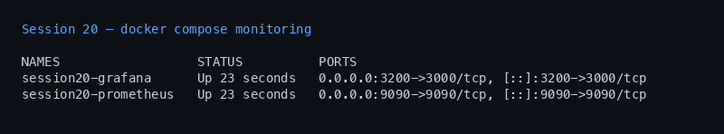
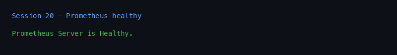
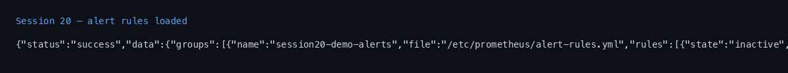
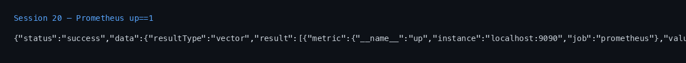
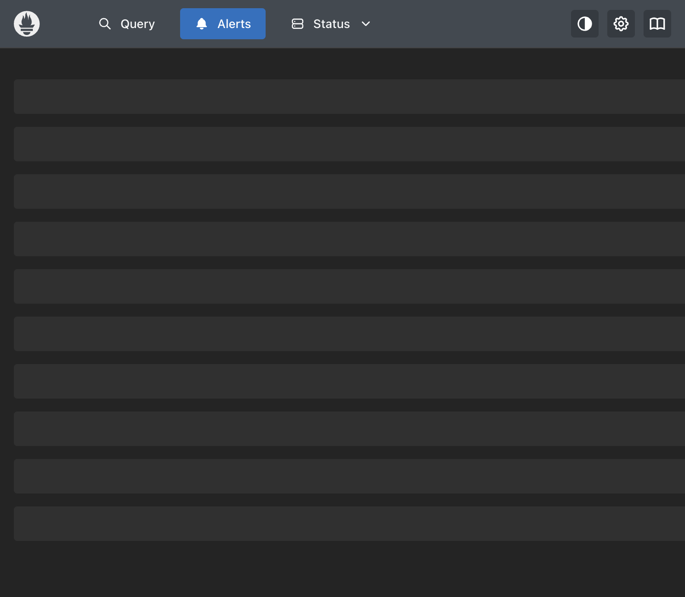
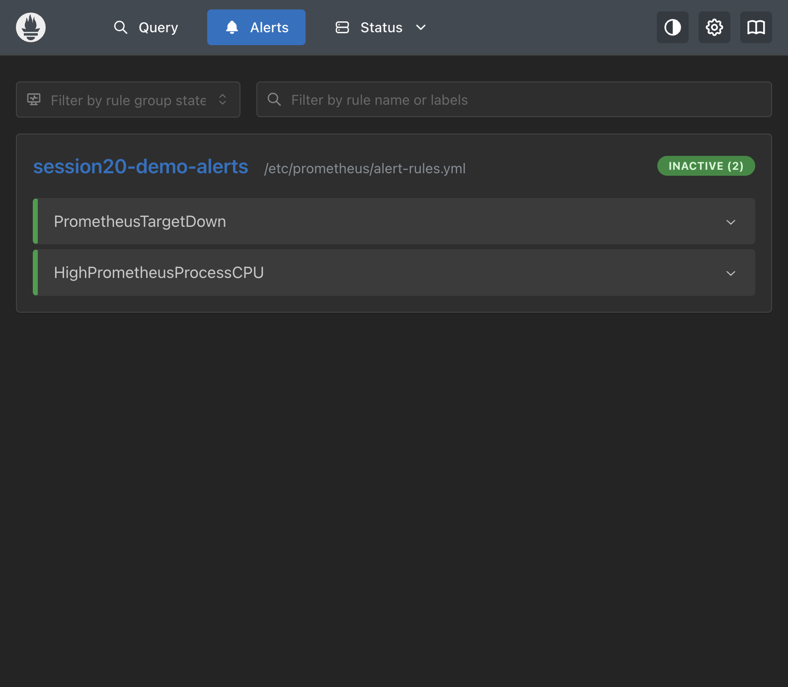
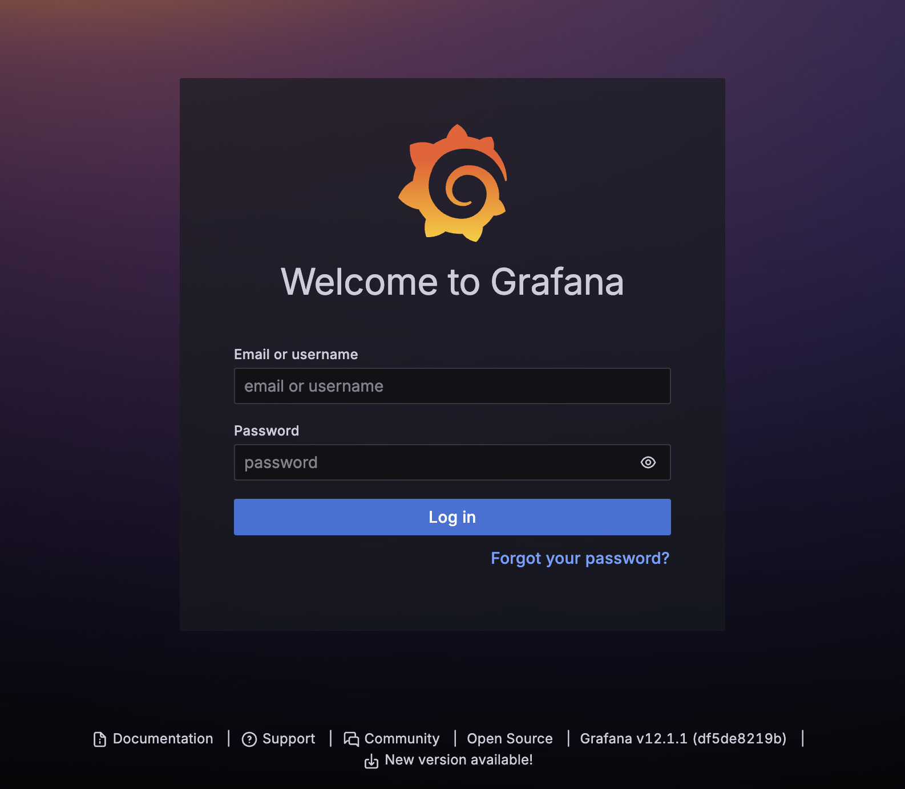
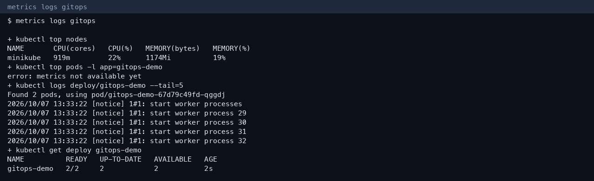
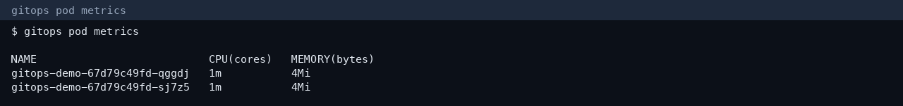

# Session 20 — Monitoring, Observability & GitOps

**Author:** Kushal S  
**Enrollment:** 24bcs10355

## Task 1 — Monitoring demo

Runnable stack: [`monitoring/`](monitoring/)

```bash
cd monitoring
docker compose up -d
# Prometheus :9090
# Grafana    :3200  (admin / admin)
```

| Signal | Demo | Evidence |
|---|---|---|
| Metrics | Prometheus `up == 1` | screenshots below |
| Logs | container / kubectl logs | earlier observe shots |
| Alerts | `session20-demo-alerts` rules loaded | Alerts UI screenshot |
| App health | Grafana login HTTP 200 | Grafana UI screenshot |

### Screenshots / proof

#### Containers up



#### Prometheus healthy



#### Alert rules JSON



#### `up` query result



#### Prometheus UI — `up` = 1



#### Prometheus Alerts UI — rules loaded (INACTIVE)



#### Grafana login UI (v12.1.1)



#### Earlier Minikube observe shots





## Task 2 — Observability

Full write-up: [`observability/README.md`](observability/README.md)

| Pillar | Meaning | Tools |
|---|---|---|
| Metrics | Numbers over time | Prometheus, Grafana |
| Logs | Discrete events | Loki, Fluent Bit, `kubectl logs` |
| Traces | Request path | OpenTelemetry, Jaeger, Tempo |

## Task 3 — GitOps

See [`gitops/README.md`](gitops/README.md).

| Idea | Demo |
|---|---|
| Git as source of truth | `gitops/app/*.yaml` |
| Declarative config | `replicas: 2` |
| Continuous reconciliation | Argo CD Application with `selfHeal: true` |
| Manual reconcile | `kubectl apply -f gitops/app/` |

```bash
kubectl apply -f gitops/app/deployment.yaml -f gitops/app/service.yaml
# After Argo CD install (course lab):
# kubectl apply -f gitops/app/argocd-application.yaml -n argocd
```
